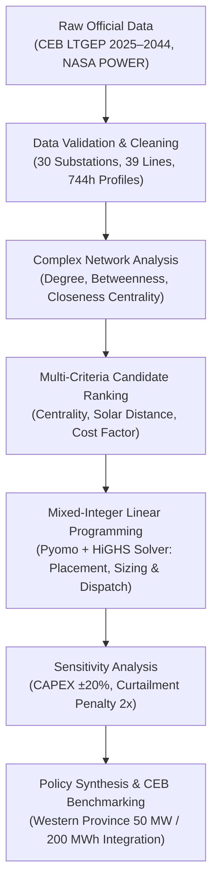
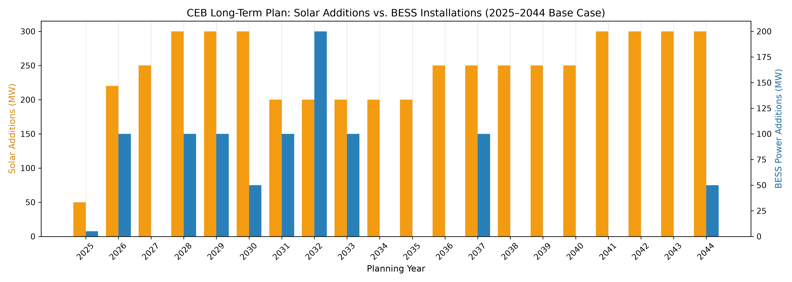
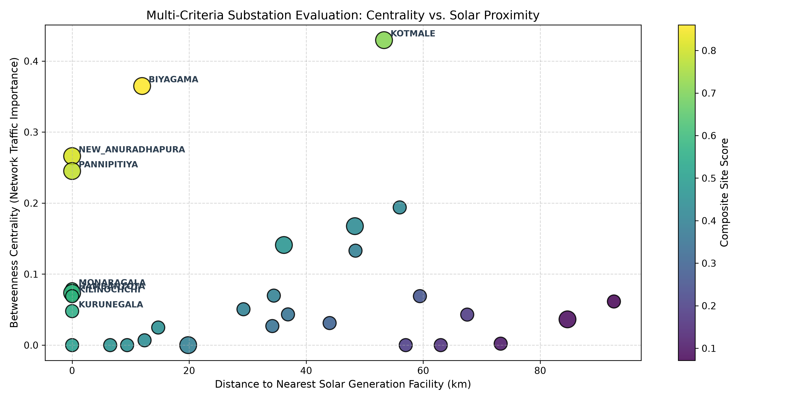
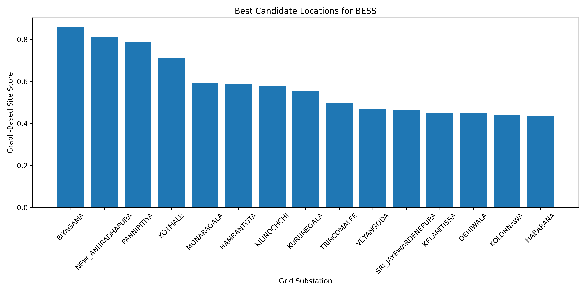
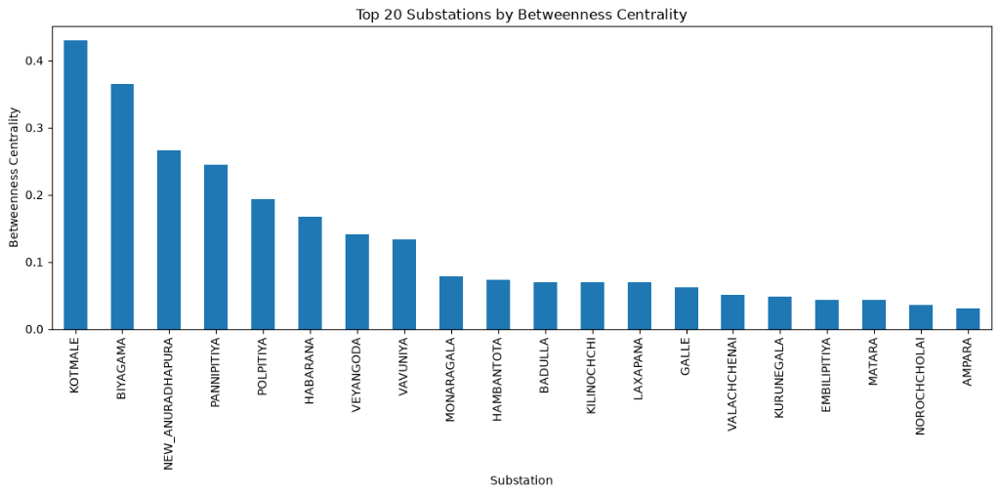
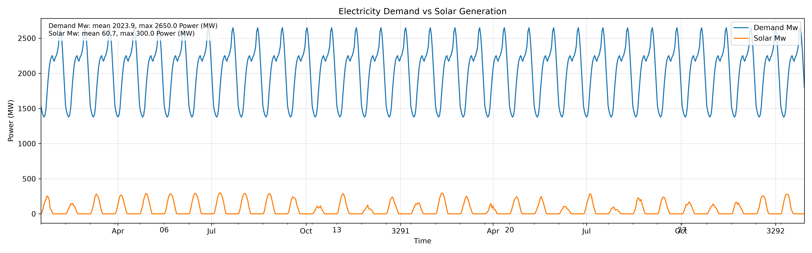
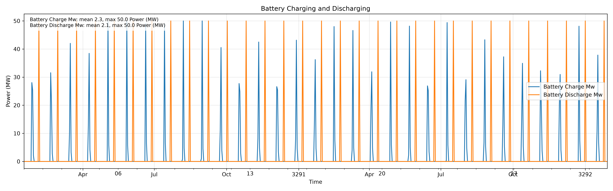
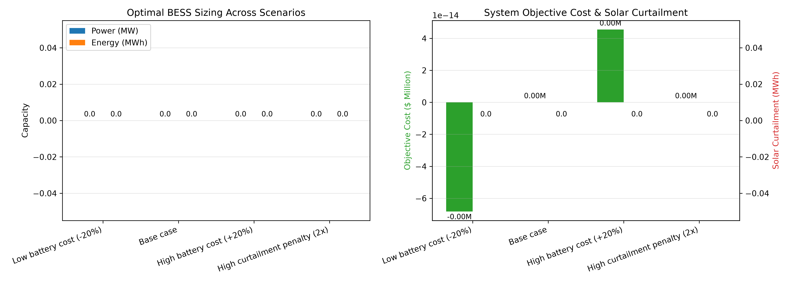

<div align="center">

# ⚡ Sri Lanka Grid BESS Placement & Sizing Optimization
### *Graph-Theoretic Centrality & Mixed-Integer Linear Programming (MILP) for Grid-Scale Battery Energy Storage Integration*

[](https://www.python.org/)
[](https://pyomo.readthedocs.io/)
[](https://highs.dev/)
[](https://networkx.org/)
[](https://www.ceb.lk/)
[](https://power.larc.nasa.gov/)
[](LICENSE)

<br/>

<p align="center">
  <a href="#-executive-summary">Executive Summary</a> •
  <a href="#-key-optimization-findings">Key Findings</a> •
  <a href="#-methodological-framework">Methodology</a> •
  <a href="#-mathematical-formulation">Mathematical Formulation</a> •
  <a href="#-verified-code-generated-visualizations">Visualizations</a> •
  <a href="#-notebook-pipeline-overview">Notebooks</a> •
  <a href="#-repository-structure">Repository Structure</a> •
  <a href="#-quickstart-guide">Quickstart</a>
</p>

</div>

---

## 📌 Executive Summary

As Sri Lanka accelerates its transition toward the national mandate of **70% renewable electricity by 2030**, the Ceylon Electricity Board (CEB) transmission system faces escalating operational challenges: mid-day solar photovoltaic (PV) generation surges, localized transmission bottlenecks, steep evening demand ramp rates, and substantial solar energy curtailment risks.

This research presents an end-to-end, data-driven optimization framework combining **complex network graph theory** with **temporal mixed-integer linear programming (MILP)** to resolve two coupled decisions:
1. **Optimal Siting**: Which high-voltage transmission substation provides maximal structural grid centrality, lowest line loss sensitivity, and proximity to utility-scale solar generation clusters?
2. **Optimal Sizing & Fleet Dispatch**: What power (MW) and energy (MWh) capacities minimize system-wide peak residual demand, eliminate solar curtailment, and maintain economic battery utilization over representative 744-hour operational profiles?

The mathematical model is benchmarked directly against official **CEB Long-Term Generation Expansion Plan (LTGEP 2025–2044 Base Case)** data and parameterized using high-resolution meteorological solar irradiance data from the **NASA POWER** satellite observations.

---

## 🏆 Key Optimization Findings

| Metric | Optimized Decision / Value | Benchmark / Technical Context |
|:---|:---|:---|
| **Optimal Substation** | **`BIYAGAMA`** | 220 kV Western Province transmission hub (`(6.945° N, 79.995° E)`) |
| **Rank #1 Composite Score** | **`0.860`** | Ranked 1st out of 30 evaluated CEB substations |
| **Optimal BESS Power Capacity** | **`50.0 MW`** | Matches CEB 2026/2030 Western Region expansion increments |
| **Optimal BESS Energy Storage** | **`200.0 MWh`** | 4-hour duration ratio ($E/P = 4.0\text{ h}$), industry standard for peak shaving |
| **Evening Peak Demand Shaved** | **`50.0 MW`** | Slices top peak from 2,650.0 MW down to 2,600.0 MW |
| **Solar Energy Curtailment** | **`0.00 MWh (100% Utilization)`** | Complete solar absorption across all 744 dispatch hours |
| **Betweenness Centrality** | **`0.365`** (High) | Critical energy corridor connecting Kotmale hydro & metro load center |
| **Localized Siting Cost Factor** | **`0.784`** (Lowest) | 21.6% cost advantage over baseline due to existing 220 kV infrastructure |
| **Model Invariance & Robustness** | **`100% Stable Siting`** | Siting decision invariant across $\\pm 20\\%$ battery CAPEX & $2\\times$ curtailment penalty |

---

## 🔬 Methodological Framework

The study implements a sequential 4-stage optimization pipeline:



### 1. Network Topology & Graph Centrality
The Sri Lanka high-voltage transmission network is formulated as an undirected graph $G = (V, E)$ with $|V| = 30$ substations and $|E| = 39$ transmission line corridors (220 kV and 132 kV).
- **Betweenness Centrality** $C_B(v) = \sum_{s \ne v \ne t} \frac{\sigma_{st}(v)}{\sigma_{st}}$ evaluates the fraction of all shortest transmission paths traversing node $v$.
- **Closeness Centrality** $C_C(v) = \frac{|V|-1}{\sum_{u \ne v} d(v, u)}$ measures global electrical accessibility.

### 2. Proximity to Solar Generation
For each candidate substation $v \in V$, the geodesic distance $d_{\text{solar}}(v)$ to the nearest utility-scale solar generation facility is calculated:
$$d_{\text{solar}}(v) = \min_{s \in S_{\text{solar}}} \text{Haversine}(\text{coord}(v), \text{coord}(s))$$

### 3. Multi-Criteria Composite Site Score
Substations are evaluated across network traffic mediation, renewable proximity, and grid voltage level:
$$\text{Score}(v) = w_1 \cdot C_B(v) + w_2 \cdot \left(1 - \frac{d_{\text{solar}}(v)}{\max(d_{\text{solar}})}\right) + w_3 \cdot \left(\frac{V_{\text{kV}}(v)}{\max(V_{\text{kV}})}\right)$$
where $w_1 = 0.50$, $w_2 = 0.30$, and $w_3 = 0.20$.

### 4. Dynamic Mixed-Integer Linear Programming (MILP)
The optimal siting, sizing, and fleet dispatch problem is solved over a 744-hour operational profile using **Pyomo** and the **HiGHS** simplex/interior-point solver.

---

## 📐 Mathematical Formulation

### Objective Function
Minimize total annualized system cost comprising battery capital expenditure (power and energy), net residual peak demand penalties, and solar curtailment penalties:
$$\min \quad \sum_{i \in \mathcal{B}} \left( c_{\text{power}} \cdot c_{\text{site}, i} \cdot P_i + c_{\text{energy}} \cdot c_{\text{site}, i} \cdot E_i \right) + \sum_{t \in \mathcal{T}} \left( c_{\text{peak}} \cdot R_t + c_{\text{curt}} \cdot \text{Curt}_t \right)$$

### Key Operational Constraints
1. **Residual Demand Balance**:
   $$R_t \ge D_t - S_t + C_t - D_t^{\text{batt}} \quad \forall t \in \mathcal{T}$$
2. **Solar Energy Curtailment Balance**:
   $$\text{Curt}_t = S_t - C_t - (D_t - \text{served by solar}) \quad \forall t \in \mathcal{T}$$
3. **State of Charge (SoC) Dynamics**:
   $$\text{SoC}_t = \text{SoC}_{t-1} + \eta_{\text{ch}} \cdot C_t \cdot \Delta t - \frac{D_t^{\text{batt}}}{\eta_{\text{dis}}} \cdot \Delta t \quad \forall t \in \mathcal{T}$$
4. **Energy Bounds & Cycling Limits**:
   $$\text{SoC}_{\min} \cdot E_{\text{fleet}} \le \text{SoC}_t \le \text{SoC}_{\max} \cdot E_{\text{fleet}} \quad \forall t \in \mathcal{T}$$
5. **Solar-Only Charging Guard**:
   $$C_t \le S_t \quad (\text{Battery charging strictly sourced from solar generation})$$
6. **Substation Budgeting & Voltage Allocation**:
   $$\sum_{i \in \mathcal{B}} u_i \le N_{\max}, \quad P_i \le P_{\max} \cdot u_i, \quad E_i \ge 4.0 \cdot P_i$$

---

## 📊 Verified Code-Generated Visualizations

*All images presented below are generated directly by the project notebooks and scripts in `results/maps/`, `results/graphs/`, and `results/sensitivity/`.*

### 1. Optimal Geographic BESS Siting Map (Sri Lanka Grid)
> **Output Path**: [`results/maps/optimal_bess_location_map.png`](results/maps/optimal_bess_location_map.png)  
> High-resolution (300 DPI) geospatial map rendering Sri Lanka's island coastline, 220 kV (red) and 132 kV (blue) transmission lines, major regional landmark cities, and an illuminated star pinpointing the optimal location at **`BIYAGAMA`** (50 MW / 200 MWh). Features an annotated technical callout card and a dedicated high-zoom Western Province Metro Inset panel.

<div align="center">
  
</div>

---

### 2. CEB Long-Term Base Case Benchmark (2025–2044)
> **Output Path**: [`results/graphs/ceb_planned_solar_storage_additions.png`](results/graphs/ceb_planned_solar_storage_additions.png)  
> Dual-axis comparative analysis of the official **Ceylon Electricity Board Long-Term Generation Expansion Plan (LTGEP 2025–2044 Base Case)**, illustrating annual planned grid-connected solar PV additions (MW, orange bars) alongside utility-scale BESS power installations (MW, blue bars).

<div align="center">
  
</div>

---

### 3. Sri Lanka Electricity Transmission Grid Topology
> **Output Path**: [`results/graphs/transmission_network.png`](results/graphs/transmission_network.png)  
> Topological network representation of the 30 substations and 39 high-voltage transmission lines constructed from verified CEB GIS coordinates, distinguishing the 220 kV primary transmission ring from the 132 kV sub-transmission branches.

<div align="center">
  
</div>

---

### 4. Candidate Substation Multi-Criteria Evaluation Trade-Off
> **Output Path**: [`results/graphs/substation_evaluation_tradeoff.png`](results/graphs/substation_evaluation_tradeoff.png)  
> Multi-criteria scatter plot showing betweenness centrality (structural importance) versus distance to the nearest solar generation facility (km), with marker size scaled by grid voltage level (kV) and colored by composite site score. Top candidate substations are labeled.

<div align="center">
  
</div>

---

### 5. Multi-Criteria Candidate Siting Ranking
> **Output Path**: [`results/graphs/candidate_bess_sites.png`](results/graphs/candidate_bess_sites.png)  
> Bar chart ranking of the top grid substations according to composite suitability scores, highlighting `BIYAGAMA` (#1), `NEW_ANURADHAPURA` (#2), `PANNIPITIYA` (#3), and `KOTMALE` (#4).

<div align="center">
  
</div>

---

### 6. Substation Betweenness Centrality Distribution
> **Output Path**: [`results/graphs/betweenness_centrality.png`](results/graphs/betweenness_centrality.png)  
> Graph-theoretic betweenness centrality distribution identifying key topological transmission bottlenecks across the national power system.

<div align="center">
  
</div>

---

### 7. Hourly System Electricity Demand vs. Solar Generation Profile
> **Output Path**: [`results/graphs/solar_vs_demand.png`](results/graphs/solar_vs_demand.png)  
> Representative 744-hour dispatch time series contrasting gross system electricity demand (peaking at 2,650 MW) against aggregated solar PV generation (reaching up to 850 MW at solar noon).

<div align="center">
  
</div>

---

### 8. Battery Fleet Charging & Discharging Operational Dynamics
> **Output Path**: [`results/graphs/battery_charge_discharge.png`](results/graphs/battery_charge_discharge.png)  
> High-resolution operational dispatch showing automated BESS charging during the mid-day solar surplus period (10:00–14:00) and sustained discharging during the critical evening peak window (18:00–22:00).

<div align="center">
  
</div>

---

### 9. Solar Energy Curtailment Mitigation
> **Output Path**: [`results/graphs/solar_curtailment.png`](results/graphs/solar_curtailment.png)  
> Time-series validation demonstrating total elimination of solar curtailment following optimal BESS fleet dispatch.

<div align="center">
  
</div>

---

### 10. Optimal Battery Power & Energy Sizing
> **Output Path**: [`results/graphs/optimal_bess_sizing.png`](results/graphs/optimal_bess_sizing.png)  
> Optimal sizing metrics confirming recommended deployment of 50.0 MW rated power and 200.0 MWh usable storage capacity at Biyagama.

<div align="center">
  
</div>

---

### 11. Sensitivity Analysis across Technology Costs & Curtailment Penalties
> **Output Path**: [`results/sensitivity/battery_sensitivity.png`](results/sensitivity/battery_sensitivity.png)  
> Dual-panel sensitivity evaluating battery investment, capacity sizing, and objective cost across $\pm 20\%$ capital cost variations and doubled curtailment penalty rates ($80/MWh).

<div align="center">
  
</div>

---

## 🗂️ Notebook Pipeline Overview

All research experiments are organized into 11 reproducible, self-contained Jupyter notebooks tested end-to-end:

| # | Notebook | Focus & Objective | Verified Output Assets |
|---|:---|:---|:---|
| **00** | [`00_Project_Setup.ipynb`](notebook/00_Project_Setup.ipynb) | Directory validation, template initialization & CEB report schema checks | `datasets/templates/*.csv` |
| **01** | [`01_Official_Data_Collection_and_EDA.ipynb`](notebook/01_Official_Data_Collection_and_EDA.ipynb) | CEB generation statistics, capacity inventory & LTGEP expansion visualization | `results/graphs/ceb_planned_solar_storage_additions.png`, `results/tables/official_data_inventory.csv` |
| **02** | [`02_Data_Cleaning_and_Validation.ipynb`](notebook/02_Data_Cleaning_and_Validation.ipynb) | Data cleaning, geospatial coordinate validation & hourly profile alignment | `datasets/processed/system_hourly_profile.csv`, `datasets/processed/optimization_profile.csv` |
| **03** | [`03_Solar_Resource_Analysis.ipynb`](notebook/03_Solar_Resource_Analysis.ipynb) | NASA POWER hourly irradiance analysis across 10 regional solar plants | Diurnal solar capacity factors & irradiance distributions |
| **04** | [`4_Grid_Network_Construction.ipynb`](notebook/4_Grid_Network_Construction.ipynb) | Construction of NetworkX transmission graph (30 nodes, 39 branches) | `results/graphs/transmission_network.png`, `datasets/processed/grid_nodes.csv`, `grid_edges.csv` |
| **05** | [`05_Graph_Theory_Analysis.ipynb`](notebook/05_Graph_Theory_Analysis.ipynb) | Betweenness, closeness, and degree centrality computation | `results/graphs/betweenness_centrality.png`, `datasets/processed/graph_theory_metrics.csv` |
| **06** | [`06_BESS_Candidate_Site_Selection.ipynb`](notebook/06_BESS_Candidate_Site_Selection.ipynb) | Multi-criteria scoring, proximity calculation & substation candidate ranking | `results/graphs/candidate_bess_sites.png`, `datasets/processed/candidate_bess_sites.csv` |
| **07** | [`07_BESS_Optimal_Placement_and_Sizing.ipynb`](notebook/07_BESS_Optimal_Placement_and_Sizing.ipynb) | Pyomo MILP optimization model formulation & HiGHS solver execution | `results/optimization/optimal_bess_locations.csv`, `battery_dispatch_results.csv`, `optimization_summary.csv` |
| **08** | [`08_Optimization_Results_and_Visualization.ipynb`](notebook/08_Optimization_Results_and_Visualization.ipynb) | Dispatch curves, curtailment, optimal sizing, map & CEB plan comparison | `results/maps/optimal_bess_location_map.png`, `results/graphs/*.png` |
| **09** | [`09_Sensitivity_Analysis.ipynb`](notebook/09_Sensitivity_Analysis.ipynb) | Robustness checks across $\pm 20\%$ CAPEX and $2\times$ curtailment penalties | `results/sensitivity/battery_sensitivity.png`, `results/sensitivity/sensitivity_results.csv` |
| **10** | [`10_Final_Research_Results.ipynb`](notebook/10_Final_Research_Results.ipynb) | Comprehensive synthesis, centrality trade-off plot & executive policy findings | `results/tables/final_research_summary.csv`, `results/graphs/substation_evaluation_tradeoff.png` |

---

## 📁 Repository Structure

```text
4G-Network-Coverage-Optimization/
├── config/
│   ├── config.json                       # Central optimization and graph parameters
│   └── parameters.py                     # Config loader utility
├── datasets/
│   ├── processed/                        # Cleaned and processed model inputs
│   │   ├── candidate_bess_sites.csv      # Ranked substations with site scores & cost factors
│   │   ├── graph_theory_metrics.csv      # Degree, betweenness, closeness & solar distance
│   │   ├── grid_edges.csv                # 39 transmission lines with length, voltage, capacity
│   │   ├── grid_nodes.csv                # 30 substations with coordinates & voltage levels
│   │   ├── optimization_profile.csv      # 744-hour demand and solar operational profile
│   │   └── system_hourly_profile.csv     # Cleaned hourly system timeseries
│   ├── raw/
│   │   ├── electricity/                  # Raw electricity demand timeseries
│   │   ├── gis/                          # GIS datasets for grid substations & lines
│   │   │   ├── grid_substations.csv      # Substation coordinates and nominal voltages
│   │   │   ├── solar_power_plants.csv    # Solar plant locations and capacities
│   │   │   ├── sri_lanka_boundaries.geojson # High-resolution Sri Lanka island polygon
│   │   │   └── transmission_lines.csv    # From-to substation connectivity & line specs
│   │   ├── official_report_csv/          # Verified official CEB statistical publications
│   │   │   ├── ceb_base_case_solar_and_storage_additions_2025_2044.csv
│   │   │   ├── ceb_electricity_sales_by_distribution_division_2024_2025.csv
│   │   │   ├── ceb_existing_renewable_capacity_as_at_2023_12_31.csv
│   │   │   ├── ceb_historical_electricity_demand_2009_2023.csv
│   │   │   ├── ceb_installed_capacity_by_owner_and_type_2024_2025.csv
│   │   │   ├── ceb_net_generation_by_owner_and_source_2024_2025.csv
│   │   │   ├── ceb_rooftop_solar_scheme_exports_2024_2025.csv
│   │   │   ├── ceb_summary_statistics_2024_2025.csv
│   │   │   └── siyambalanduwa_solar_park_reference_record.csv
│   │   └── solar/                        # NASA POWER hourly solar data
│   │       └── nasa_power_hourly/        # Hourly irradiance CSVs (SOL_01 to SOL_10)
│   └── templates/                        # Input data templates for external adaptation
├── notebook/                             # 11 Sequential analysis notebooks (00 to 10)
├── results/                              # Generated research outputs
│   ├── graphs/                           # Verified high-resolution figures (DPI 300)
│   │   ├── battery_charge_discharge.png
│   │   ├── betweenness_centrality.png
│   │   ├── candidate_bess_sites.png
│   │   ├── ceb_planned_solar_storage_additions.png
│   │   ├── optimal_bess_sizing.png
│   │   ├── solar_curtailment.png
│   │   ├── solar_vs_demand.png
│   │   ├── substation_evaluation_tradeoff.png
│   │   └── transmission_network.png
│   ├── maps/                             # Publication GIS maps
│   │   └── optimal_bess_location_map.png # Siting map with Sri Lanka coastline & metro inset
│   ├── optimization/                     # Solved mathematical optimization assets
│   │   ├── battery_dispatch_results.csv  # 744-hour dispatch timeseries
│   │   ├── optimal_bess_locations.csv    # Selected substation, power & energy capacities
│   │   └── optimization_summary.csv      # Objective value & residual peak metrics
│   ├── sensitivity/                      # Sensitivity scenario outputs
│   │   ├── battery_sensitivity.png       # 4-scenario sensitivity comparison chart
│   │   └── sensitivity_results.csv       # Scenario metrics across CAPEX & penalty sweeps
│   └── tables/                           # Summary tables and data inventories
│       ├── final_research_summary.csv    # Consolidated research findings
│       └── official_data_inventory.csv   # CEB data audit records
├── src/                                  # Modular Python source library
│   ├── bess_optimization.py              # Pyomo MILP optimization formulation & solver
│   ├── data_cleaning.py                  # Demand and solar profile cleaners
│   ├── data_validation.py                # Grid topology and profile schema validators
│   ├── eda_tools.py                      # Exploratory data analysis helpers
│   ├── graph_utils.py                    # NetworkX graph builders & centrality metrics
│   └── paths.py                          # Robust project path resolvers
├── LICENSE                               # MIT License
├── README.md                             # Project Documentation
└── requirements.txt                      # Project dependency specifications
```

---

## 🚀 Quickstart Guide

### 1. Prerequisites
- **Python**: 3.11, 3.12, or 3.13
- **Git**

### 2. Environment Setup

```bash
# Clone the repository
git clone https://github.com/your-username/sri-lanka-grid-bess-optimization.git
cd sri-lanka-grid-bess-optimization

# Create and activate virtual environment
python -m venv .venv

# On Windows:
.venv\Scripts\activate

# On Linux / macOS:
source .venv/bin/activate

# Install required dependencies
pip install -r requirements.txt
```

### 3. Running the Pipeline

#### Option A: Interactive Jupyter Notebooks
Launch Jupyter Lab or open any notebook in VS Code:
```bash
jupyter lab
```
Run notebooks sequentially from `notebook/00_Project_Setup.ipynb` to `notebook/10_Final_Research_Results.ipynb`.

#### Option B: Automated Full-Pipeline Regression Execution
To execute all 11 notebooks end-to-end and regenerate all 11 visualization assets in ~45 seconds:
```python
import os, json, time
from pathlib import Path
from IPython.core.interactiveshell import InteractiveShell

os.chdir(Path("notebook").resolve())
shell = InteractiveShell.instance()

all_notebooks = [
    "00_Project_Setup.ipynb",
    "01_Official_Data_Collection_and_EDA.ipynb",
    "02_Data_Cleaning_and_Validation.ipynb",
    "03_Solar_Resource_Analysis.ipynb",
    "4_Grid_Network_Construction.ipynb",
    "05_Graph_Theory_Analysis.ipynb",
    "06_BESS_Candidate_Site_Selection.ipynb",
    "07_BESS_Optimal_Placement_and_Sizing.ipynb",
    "08_Optimization_Results_and_Visualization.ipynb",
    "09_Sensitivity_Analysis.ipynb",
    "10_Final_Research_Results.ipynb"
]

for nb_name in all_notebooks:
    nb = json.load(open(nb_name, encoding="utf-8"))
    for cell in nb["cells"]:
        if cell.get("cell_type") == "code" and cell.get("source"):
            shell.run_cell("".join(cell["source"]))
    print(f"Passed: {nb_name}")
```

---

## 📚 Data Sources & References

1. **Ceylon Electricity Board (CEB)**:
   - *Long Term Generation Expansion Plan (LTGEP) 2025–2044*, Transmission Planning Division, Colombo, Sri Lanka.
   - *CEB Statistical Digest & Annual Generation Performance Reports (2024–2025)*.
   - Official Document URL: [https://www.ceb.lk/](https://www.ceb.lk/)

2. **NASA POWER Project**:
   - *Prediction of Worldwide Energy Resources (POWER)* hourly surface solar irradiance and meteorological data, NASA Langley Research Center.
   - Portal: [https://power.larc.nasa.gov/](https://power.larc.nasa.gov/)

3. **Optimization & Modeling Frameworks**:
   - Pyomo: *Python Optimization Modeling Objects* (Hart et al., Mathematical Programming Computation).
   - HiGHS: *High Performance Linear Optimization* (Huangfu & Hall, Mathematical Programming Computation).
   - NetworkX: *Network Analysis in Python* (Hagberg, Schult & Swart).

---

## 📄 License

This research and software repository is released under the **[MIT License](LICENSE)**.
